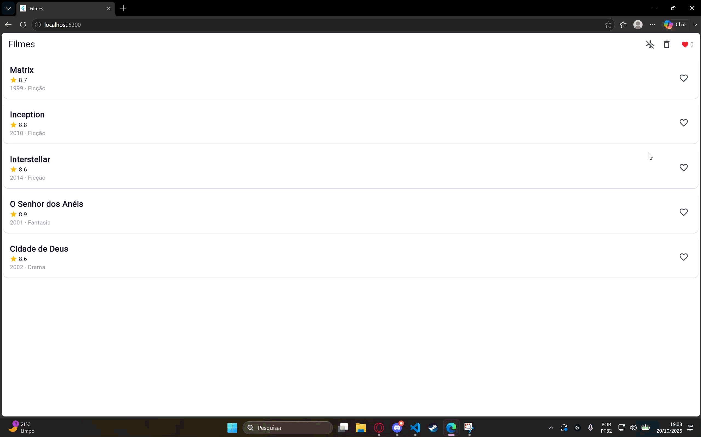

# Atividade 3 — Flutter, Firebase e offline-first

Aluno: Rafael Corrêa Zart.

Versão ajustada ao enunciado atual: UI e estado compartilhado com Riverpod,
favoritos no Firestore, cache-first com TTL de 10 minutos, aviso de conexão,
serialização JSON e fila persistente de sincronização.

## Executar

Requer Flutter instalado. Nesta pasta:

```powershell
flutter pub get
flutter run -d edge --web-port 5300
```

A porta fixa é importante: o armazenamento do navegador pertence à origem
(endereço e porta). Sem Firebase configurado, o app avisa que os favoritos
são apenas locais à sessão. O cache dos filmes já sobrevive ao reload.

## Configurar Firebase

1. Crie seu projeto gratuito no Firebase e registre um aplicativo Web.
2. Ative o Cloud Firestore. Não é necessário Remote Config nesta atividade.
3. Copie `firebase.local.example.json` para `firebase.local.json`.
4. Preencha os campos com a configuração Web do seu projeto:
   apiKey, appId, messagingSenderId, projectId, authDomain e storageBucket,
   nos respectivos campos FIREBASE_* do JSON.
5. Configure as regras para permitir a leitura e escrita do documento
   `favorites/meus-favoritos` no projeto didático, conforme o enunciado.
6. Execute:

```powershell
flutter run -d edge --web-port 5300 --dart-define-from-file=firebase.local.json
```

O arquivo local está ignorado pelo Git. Outra opção é usar `flutterfire configure`
para gerar `lib/firebase_options.dart` e executar sem o argumento JSON.
O app inicializa o Firebase e ativa a persistência offline antes de montar
os providers. Favoritar e limpar atualizam a tela imediatamente e gravam o
documento; snapshots refletem atualizações de outras abas. Os testes usam
uma fonte de favoritos substituível e não acessam um projeto real.

## Validar

```powershell
flutter analyze
flutter test
flutter build web
```

Os testes originais de UI e checklist foram preservados. O arquivo
`test/offline_test.dart` foi incorporado sem alterações do enunciado atual
do professor e cobre as TASKs 11–15. Há também teste da integração do provider
com uma fonte de nuvem falsa; isso não substitui a prova real no Firestore.

### Cache e fila

O repositório emite primeiro o cache. Se fresco, não acessa a API.
Se vencido, busca e salva os dados atualizados. Sem rede mantém o cache;
sem cache, informa que não há dados salvos. O modo avião da barra permite
testar a fonte simulada sem depender da rede real.
SharedPreferences guarda os dados entre execuções. Sem chave TMDB, a fonte
simulada usa os cinco filmes da atividade.

SyncQueue não duplica operações com o mesmo ID nem a mesma ação para o
mesmo filme; ações opostas se cancelam. O envio respeita a ordem, persiste
cada sucesso e para no primeiro erro. A fila está implementada e testada
isoladamente, como pede a TASK 15. A ligação da fila aos favoritos é bônus;
a integração atual usa a própria sincronização offline do Firestore.

## Estado local, cloud e offline-first

O provider evita passar estado por widgets intermediários e permite que card,
contador e limpeza compartilhem a mesma fonte de estado. O estado local reage
rápido e funciona sem rede, mas sozinho não sincroniza entre dispositivos.
O Firestore persiste e compartilha favoritos, acrescentando latência e possíveis
falhas de acesso; a atualização otimista mantém a interface responsiva.
Na abordagem offline-first, o cache local aparece primeiro e o repositório
revalida quando necessário: o TTL reduz chamadas, aceitando dados possivelmente
antigos por alguns minutos. A fila preserva operações pendentes, elimina ações
redundantes e permite retomar o envio após uma falha.

## Evidência de entrega

Gravação do fluxo de favoritar e recarregar a página, com os favoritos
preservados após o reload, usando a configuração Firebase do projeto.


